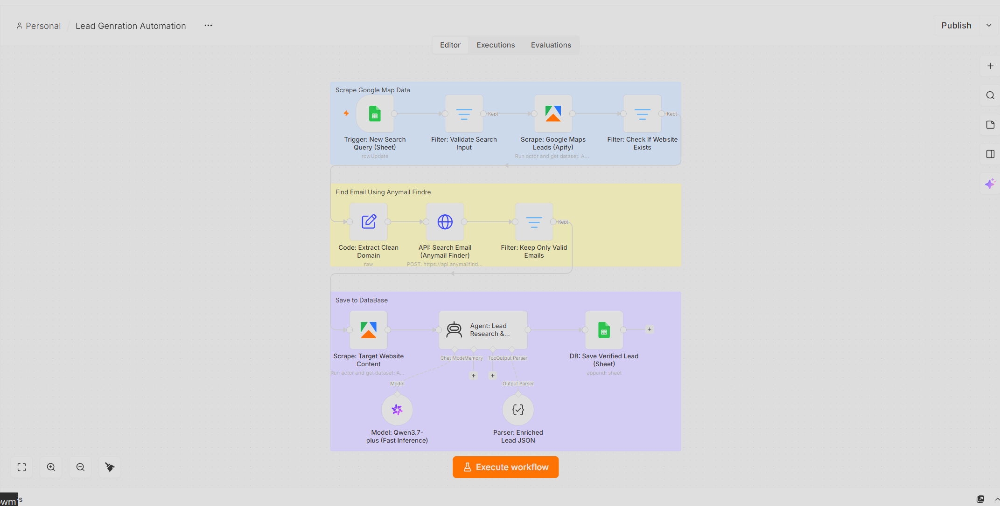

# 🎯 AI B2B Lead Generation & Enrichment Pipeline

An enterprise-grade, autonomous B2B lead generation and email personalization system orchestrated in **n8n**. This pipeline fully automates prospect discovery by scraping Google Maps via Apify, extracting verified decision-maker emails using Anymail Finder, crawling target company websites, utilizing **Alibaba Cloud Qwen LLMs** for deep lead research, and storing enriched data into Google Sheets—all running securely on a **self-hosted Docker infrastructure on a local server**.

---

## 🌟 Executive Summary
Manual outbound lead generation is slow and generic. This automated workflow acts as an AI-powered sales development representative (SDR). It monitors Google Sheet search queries, scrapes local business listings, verifies CEO/Decision-maker contact info, analyzes target website content, and crafts highly tailored, context-aware cold-email icebreakers. All backend operations run locally via Docker for absolute data privacy and cost efficiency.

---

## 🖼️ System Architecture

### Core n8n Workflow Architecture
*The complete multi-stage orchestration canvas showing Google Sheets triggers, Apify scrapers, Anymail Finder API, and Qwen AI enrichment agents:*

---

## ⚙️ Core Tech Stack & AI Models

### 1. Infrastructure & Orchestration
- **Engine:** n8n (Self-Hosted via Docker Desktop on Local Server Environment)
- **Trigger:** Google Sheets Trigger (Monitors new search parameters and row updates every minute).

### 2. Scraping & Data Enrichment Engines
- **Map Scraper:** Apify Actor (`Google Maps Scraper`) for extracting local business details, categories, and websites.
- **Email Finder:** Anymail Finder API (`/v5.1/find-email/decision-maker`) for fetching verified CEO contact emails.
- **Web Scraper:** Apify Web Scraper for extracting raw textual context from target company websites.

### 3. AI Intelligence & Generation
- **Lead Research Brain:** Alibaba Cloud Qwen (`qwen3.7-plus`) configured as a LangChain ReAct agent.
- **Output Parser:** Structured JSON schema enforcing concise subject lines, custom icebreakers, and full cold-email body formatting.

---

## 🚀 The Automated Pipeline Flow

1. **Trigger & Filtering:** The workflow triggers when a new search query (e.g., location and company type) is added to Google Sheets and marked as `Run`.
2. **Maps Scraping:** Apify crawls Google Maps to gather business titles, categories, and official website URLs.
3. **Domain Cleaning & Email Finding:** A custom JavaScript code node extracts clean root domains, which are then queried via Anymail Finder to discover verified decision-maker emails.
4. **Website Crawling & AI Personalization:** Validated leads trigger the Apify website scraper. The **Qwen LLM Agent** reads the scraped website text to generate hyper-personalized, non-generic cold email icebreakers tailored to the prospect.
5. **Database Sync:** The enriched lead data, verified email, and AI-generated icebreaker are automatically appended back into the Google Sheets database.

---

## 👨‍💻 Engineering Highlights & Problem Solving

- **Secure Dockerized Local Environment:** Fully self-hosted on a local Docker container, protecting sensitive scraping tokens, API credentials, and proprietary prospect databases from third-party cloud exposure.
- **Advanced Domain Sanitization:** Built a robust custom JavaScript domain cleaning block (`replace` and `split` functions) to strip URL protocols, `www` prefixes, and subpaths before sending requests to the Anymail Finder API.
- **Structured JSON Formatting for Outbound Sales:** Enforced strict JSON schema outputs from the Qwen LLM to ensure seamless mapping into downstream CRM and email dispatch channels without markdown parsing errors.

---
*Architected and Developed by **Abu Bakar Siddique** (@hafiz-abubakar-dev) — AI Automation Engineer*
